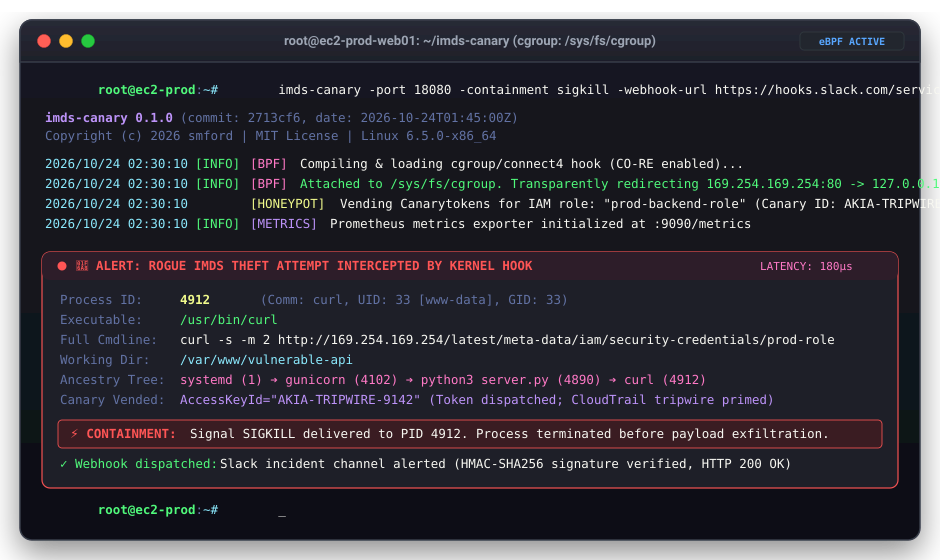

# imds-canary

[](https://github.com/smford/imds-canary/actions/workflows/ci.yml)
[](https://github.com/smford/imds-canary/actions/workflows/sast.yml)
[](https://github.com/smford/imds-canary/actions/workflows/scorecard.yml)
[](LICENSE)

**`imds-canary`** is a host security daemon for Linux servers and containers that silently intercepts rogue processes attempting to steal cloud credentials from the AWS Instance Metadata Service (IMDS: `169.254.169.254`).

Instead of letting an attacker steal your real cloud credentials—or simply blocking the request and tipping them off—`imds-canary` transparently redirects the connection to an embedded Go honeypot, hands the intruder a trackable **AWS Canarytoken**, resolves the full calling process tree via `/proc`, and alerts your security team in real time.



---

## The Problem in Plain English

Every virtual machine running in AWS has access to a special internal IP address: `169.254.169.254`. This is the **Instance Metadata Service (IMDS)**. When software running on that machine needs to talk to AWS services (like S3, DynamoDB, or Secrets Manager), it queries this IP address to automatically receive temporary IAM security credentials.

While convenient for legitimate applications, IMDS is **public enemy number one in cloud breaches**:

1. **The Instant Reflex of Every Cloud Intruder**:
   The moment an attacker exploits a Server-Side Request Forgery (SSRF) bug in your web app, escapes a container, or executes code through a compromised npm/PyPI package, their very first command is almost always:
   ```bash
   curl http://169.254.169.254/latest/meta-data/iam/security-credentials/
   ```
   They do this because it instantly hands them the keys to your cloud infrastructure.

2. **Silent Exfiltration & CloudTrail Blind Spots**:
   Once stolen, attackers copy those credentials off your server and use them from their own laptops. Traditional cloud auditing (AWS CloudTrail) can only tell you that a credential was used; **it cannot tell you which process on your server stole it**, what command-line flags were passed, or what user ran it.

3. **The Catch-22 of Blocking IMDS**:
   If you block IMDS outright with firewall rules, attackers immediately know you detected them and switch to stealthier persistence. Furthermore, legitimate management tools (like the AWS Systems Manager Agent) may break.

---

## How `imds-canary` Solves This

`imds-canary` turns the attacker's favorite technique into an invisible trap:

```
                     ┌────────────────────────────────────────┐
                     │   Rogue Process (e.g., curl, python)   │
                     └──────────────────┬─────────────────────┘
                                        │ connect(169.254.169.254:80)
                                        ▼
             ┌────────────────────────────────────────────────────────┐
             │       Kernel eBPF Socket Hook (cgroup/connect4)        │
             │       - Rewrites destination: 127.0.0.1:18080          │
             │       - Emits calling PID/TGID/UID into BPF Ring Buffer│
             └──────────────┬─────────────────────────┬───────────────┘
                            │                         │
     Redirected TCP Traffic │                         │ BPF Ring Buffer Event
                            ▼                         ▼
┌──────────────────────────────────────┐   ┌──────────────────────────────────┐
│        Go HTTP Honeypot              │   │   Process Attribution Engine     │
│ - IMDSv1 & IMDSv2 Support            │   │ - Resolves /proc/<pid>/exe       │
│ - PUT /latest/api/token (IMDSv2)     │   │ - Resolves /proc/<pid>/cmdline   │
│ - GET /latest/meta-data/iam/...      │   │ - Resolves /proc/<pid>/cwd       │
│ - Vends canary AWS STS credentials   │   │ - Traverses Parent/Grandparents  │
└──────────────────┬───────────────────┘   └──────────────────┬───────────────┘
                   │                                          │
                   └──────────────────┬───────────────────────┘
                                      ▼
             ┌────────────────────────────────────────────────────────┐
             │         Structured Security Telemetry & Action         │
             │ - JSON & ArcSight CEF Syslog Alerts                    │
             │ - Asynchronous Webhook Egress (Slack, SIEM)            │
             │ - Prometheus Telemetry (/metrics)                      │
             │ - Active Threat Containment (SIGKILL / SIGSTOP)        │
             └────────────────────────────────────────────────────────┘
```

1. **Invisible Trap at the Socket Layer**:
   Using modern Linux eBPF (`cgroup/connect4`), `imds-canary` catches connection attempts directly in the Linux kernel before packets even hit the network stack. Normal network traffic is untouched.

2. **Deceptive Canary Vending**:
   The intruder is redirected to a local Go honeypot supporting both IMDSv1 and IMDSv2. When they request security credentials, `imds-canary` returns a trackable Canarytoken. The attacker thinks they succeeded. The moment they use those credentials from anywhere on earth, an AWS tripwire alarm fires!

3. **Complete Process Attribution in Microseconds**:
   While the connection is redirected, the daemon inspects `/proc` to capture the caller's:
   - Process ID (`pid`) and Thread ID (`tid`)
   - Executable path (e.g., `/usr/bin/curl` or `/usr/local/bin/python3`)
   - Complete command-line arguments (e.g., `["python3", "exploit.py", "--target", "..."]`)
   - Working directory (`cwd`)
   - Complete parent and grandparent ancestry chain (e.g., `curl -> bash -> sshd -> systemd`)

4. **Multi-Channel Alerting & Active Defense**:
   - **Real-Time Webhooks**: Dispatches HMAC-signed JSON alerts to Slack, Discord, or your SIEM.
   - **Enterprise SIEM Logs**: Emits structured JSON or ArcSight Common Event Format (CEF) logs.
   - **Prometheus Metrics**: Exposes `/metrics` tracking intercepted probes and vended credentials.
   - **Active Containment**: Optionally terminates (`SIGKILL`) or freezes (`SIGSTOP`) the offending process on the spot.
   - **Sanctioned Process Allowlist**: Excludes legitimate cloud agents (such as `amazon-ssm-agent`) by binary name or path.

---

## Quickstart

### 1. Build

```bash
make all
```

Output binary: `bin/imds-canary`.

### 2. Run in Production (Linux Host / Root)

```bash
sudo ./bin/imds-canary \
  -port 18080 \
  -cgroup /sys/fs/cgroup \
  -role production-infra-role \
  -access-key-id "AKIA-CANARY-TOKEN-ID" \
  -secret-access-key "SECRET-CANARY-KEY" \
  -webhook-url "https://hooks.slack.com/services/T00/B00/XXX"
```

### 3. Run in Dry-Run Mode (Testing without eBPF / Non-Root)

You can run and test `imds-canary` on macOS or non-root environments:

```bash
./bin/imds-canary -dry-run -port 18080
```

### 4. Diagnostic Self-Test

Verify your alerting and webhook pipeline in CI or staging servers without needing root privileges:

```bash
./bin/imds-canary -test-intercept
```

---

## Worked Examples

Practical, step-by-step guides for common scenarios:

- [**Example 1: Quickstart in Dry-Run Mode**](examples/01-quickstart-dry-run/README.md) – Test IMDSv1 and IMDSv2 queries locally in 60 seconds.
- [**Example 2: Simulating & Catching an SSRF Attack**](examples/02-ssrf-simulation/README.md) – Catching an attacker exploiting a vulnerable web application.
- [**Example 3: Real-Time Slack & Webhook Alerting**](examples/03-slack-webhook-alerting/README.md) – Setting up HMAC-signed notifications to Slack or your SIEM.
- [**Example 4: Active Threat Containment with SIGKILL**](examples/04-threat-containment-sigkill/README.md) – Automatically killing rogue processes attempting to steal credentials.
- [**Example 5: Integrating with AWS Canarytokens**](examples/05-aws-canarytokens-setup/README.md) – Generating and loading trackable tokens from Thinkst Canary.
- [**Example 6: Deploying on EC2 with Systemd**](examples/06-systemd-production-ec2/README.md) – Production deployment on Amazon Linux 2023 or Ubuntu.

---

## Operational Endpoints

| Endpoint | Method | Description |
|---|---|---|
| `/healthz` | `GET` | Health and liveness probe (bypasses security alerts) |
| `/livez` | `GET` | Liveness check for Kubernetes/systemd |
| `/metrics` | `GET` | Prometheus/OpenMetrics exposition |
| `/latest/api/token` | `PUT` | IMDSv2 session token negotiation |
| `/latest/meta-data/` | `GET` | Metadata directory listing |
| `/latest/meta-data/iam/security-credentials/<role>` | `GET` | Canary AWS STS credentials vending |
| `/latest/dynamic/instance-identity/document` | `GET` | Mock AWS instance identity document |

---

## Command-Line Options

```
Usage of imds-canary:
  -action string
        Mitigation action on rogue access: alert, pause, kill, none (default "alert")
  -allowlist string
        Comma-separated process names or paths permitted to access IMDS
  -access-key-id string
        Canary AWS Access Key ID (default "AKIAEXAMPLECANARYKEY1")
  -secret-access-key string
        Canary AWS Secret Access Key
  -session-token string
        Canary AWS Session Token
  -role string
        Mock IAM role name (default "production-infra-role")
  -port int
        Honeypot HTTP listen port (default 18080)
  -cgroup string
        Cgroup v2 root path for eBPF attachment (default "/sys/fs/cgroup")
  -dry-run
        Run HTTP honeypot only without attaching eBPF
  -log-format string
        Alert log format: json, text, cef (default "json")
  -log-level string
        Log level: debug, info, warn, error (default "info")
  -webhook-url string
        URL for asynchronous real-time alert webhooks
  -webhook-secret string
        Shared HMAC secret for X-Canary-Signature webhook signing
  -test-intercept
        Run diagnostic self-test interception event and exit
  -version, -v
        Print version information and exit
```

---

## Version & License

```
imds-canary 0.1.0 (commit: feb2576..., date: 2026-10-24T01:47:24Z)
Copyright (c) 2026 smford
Licensed under the MIT License
```
