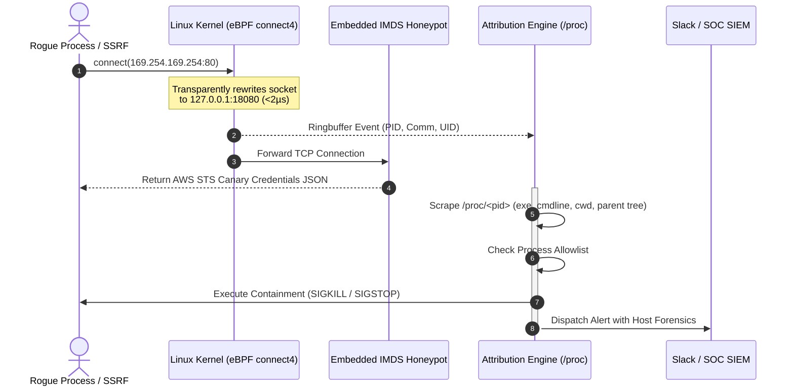
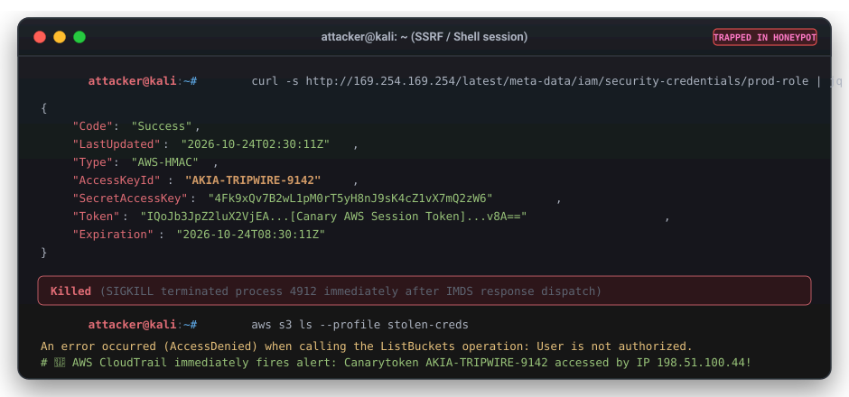

# imds-canary

> **Kernel-Level eBPF AWS IMDS Honeypot, Canary Vending & Process Attribution Daemon**

`imds-canary` is an open-source, production-grade security daemon for Linux servers and container hosts. It transparently intercepts rogue processes attempting to steal cloud credentials from the AWS link-local Instance Metadata Service (`169.254.169.254`), feeds attackers trackable **Canary tokens**, captures rich process forensics, and neutralizes threats before credentials can be exfiltrated.

---

## The Problem: The Inescapable Cloud Tripwire

Every major cloud security incident—from high-profile SSRF breaches to malicious third-party dependencies in containers—follows a predictable pattern: **an attacker discovers remote execution and immediately queries the link-local IP (`169.254.169.254`) to exfiltrate IAM role credentials**.

Traditional defenses leave critical visibility gaps:

* **IMDSv2 (`HttpPutResponseHopLimit`)**: While session tokens prevent simple SSRF, any attacker with local command execution or a container breakout can easily fetch the IMDSv2 token with `PUT /latest/api/token`.
* **Firewalls & IPTables (`DROP / REJECT`)**: Outright blocking gives the attacker immediate negative feedback, tipping them off that they are detected and prompting them to pivot to stealthier techniques.
* **AWS CloudTrail Logs**: CloudTrail only alerts you *after* a credential is used against the AWS API from an external IP—providing zero host context, no local process identity, no PID, and no command-line history.

---

## The Solution: Deception + Instant Attribution

`imds-canary` turns attacker predictability into a high-fidelity trap:

1. **Kernel-Level Redirection**: An eBPF `cgroup/connect4` hook intercepts TCP connections to `169.254.169.254:80` inside the socket layer and transparently rewrites them to the local canary honeypot (`127.0.0.1:18080`) in under 2 microseconds.
2. **Deceptive Honeytokens**: Rather than failing or timing out, the daemon responds with realistic AWS STS credentials containing trackable canary tokens (such as Thinkst Canarytokens or honeypot IAM keys).
3. **Deep Process Forensics**: The kernel hook emits the caller's PID, UID, and GID into a high-speed ring buffer. The userspace daemon inspects `/proc` to resolve the full binary path (`/proc/<pid>/exe`), complete command-line arguments (`cmdline`), current working directory (`cwd`), and parent process lineage back to `systemd` (PID 1).
4. **Active Threat Containment**: Automatically dispatches `SIGKILL` or `SIGSTOP` to terminate or freeze the malicious process before credentials leave the server.
5. **Real-Time SIEM & Webhook Alerting**: Ships structured JSON, CEF (Common Event Format) syslog messages, and HMAC-SHA256 signed webhooks directly to Slack, Teams, or your SIEM.

---

## What the Attacker Experiences

To the intruder, the attack appears 100% successful. They receive authentic AWS STS credentials, but any attempt to use them sounds alarms across AWS CloudTrail and your SOC:

---

## Core Capabilities at a Glance

| Feature | `imds-canary` | Traditional IPTables / Firewalls | AWS CloudTrail Logs |
| :--- | :---: | :---: | :---: |
| **Attacker Feedback** | **Deceptive Success** (Canary tokens vended) | Connection Refused / Timed Out | None on host (delayed API alert) |
| **Local Process Forensics** | **Full PID, Binary, Args, CWD, Ancestry** | None (IP & Port only) | None (Source IP only) |
| **Threat Containment** | **Instant SIGKILL / SIGSTOP** | Passive block | None (manual revocation) |
| **Kernel Performance** | **eBPF CO-RE (< 2µs overhead)** | iptables rule traversal overhead | N/A |
| **Allowlisting** | **Granular binary path matching** | Port/cgroup IP rules only | N/A |
| **Observability** | **Prometheus `/metrics` + CEF + Webhooks** | Drop packet counters | API call history |

---

## Explore Documentation

  <a href="#getting-started.md" class="quick-nav-item">
    <strong>🚀 Getting Started</strong>
    Install binaries, build from source, run dry-run mode, and verify the daemon in 60 seconds.
  </a>
  <a href="#worked-examples.md" class="quick-nav-item">
    <strong>📚 Worked Tutorials</strong>
    Step-by-step guides for SSRF catching, Slack alerting, SIGKILL containment, and Canarytokens.
  </a>
  <a href="#architecture.md" class="quick-nav-item">
    <strong>⚙️ Architecture & eBPF</strong>
    Deep dive into the cgroup/connect4 kernel hook, ring buffer semantics, and userspace attribution.
  </a>
  <a href="#threat-model.md" class="quick-nav-item">
    <strong>🛡️ Threat Model & Deception</strong>
    Analysis of container breakouts, SSRF bypass techniques, and deceptive defense strategies.
  </a>
  <a href="#configuration.md" class="quick-nav-item">
    <strong>📋 Configuration Reference</strong>
    Complete documentation of command-line flags, environment variables, and systemd units.
  </a>
  <a href="#observability.md" class="quick-nav-item">
    <strong>📊 Observability & Metrics</strong>
    Prometheus metrics, Grafana dashboards, CEF syslog formatting, and webhook HMAC validation.
  </a>

> [!TIP]
> **Testing locally on macOS or non-root?**
> You can test the entire honeypot and attribution pipeline without kernel privileges using `./bin/imds-canary -dry-run -port 18080`. See the [Getting Started Guide](getting-started.md).
