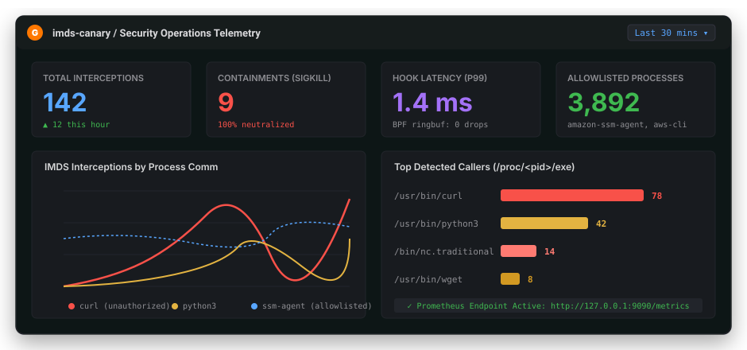

# Observability, Metrics & SIEM Integration

> **Real-time telemetry, Prometheus metrics, CEF syslog output, and webhook event streaming.**

`imds-canary` provides enterprise-grade observability to ensure security teams have full visibility into link-local queries, kernel ring buffer throughput, and threat containment actions.



---

## Prometheus Metrics

The daemon exposes Prometheus metrics on `:9090/metrics` by default (configurable via `-metrics-addr` or `CANARY_METRICS_ADDR`).

### Metric Dictionary

| Metric Name | Type | Labels | Description |
| :--- | :---: | :--- | :--- |
| `imds_interceptions_total` | Counter | `comm`, `status` | Total IMDS connection attempts intercepted by the kernel hook. |
| `imds_containment_actions_total` | Counter | `action`, `comm` | Number of threat containment actions executed (`sigkill`, `sigstop`). |
| `imds_ringbuf_events_total` | Counter | — | Total raw events consumed from the eBPF ring buffer. |
| `imds_ringbuf_drops_total` | Counter | — | Number of dropped ring buffer events (should remain 0 under normal loads). |
| `imds_honeypot_requests_total` | Counter | `path`, `code` | Total HTTP requests handled by the embedded honeypot server. |
| `imds_honeypot_duration_seconds` | Histogram | `path` | Latency distribution of honeypot HTTP response processing. |

### Sample PromQL Alerting Rule

Add this alerting rule to Prometheus / Alertmanager to immediately notify on-call teams of unauthorized metadata access:

```yaml
groups:
  - name: imds_security_alerts
    rules:
      - alert: UnauthorizedIMDSAccessAttempt
        expr: rate(imds_interceptions_total{status="unauthorized"}[1m]) > 0
        for: 0m
        labels:
          severity: critical
          tier: security
        annotations:
          summary: "Unauthorized AWS IMDS query detected from {{ $labels.comm }}"
          description: "Process {{ $labels.comm }} attempted to access link-local metadata on host {{ $labels.instance }}."
```

---

## Common Event Format (CEF) Syslog

When `-log-format cef` is configured, `imds-canary` formats security alerts using the ArcSight Common Event Format (CEF), designed for native ingestion into Splunk, Microsoft Sentinel, IBM QRadar, and Datadog.

### Sample CEF Output

```text
CEF:0|smford|imds-canary|0.1.0|IMDS_THEFT_ATTEMPT|Unauthorized IMDS Query Intercepted|8|dvc=ec2-prod-web01 src=127.0.0.1 suser=www-data spid=4912 msg=Rogue process probed AWS link-local metadata cs1=/usr/bin/curl cs1Label=ProcessPath cs2=curl -s http://169.254.169.254/latest/meta-data/ cs2Label=Cmdline cs3=systemd -> gunicorn -> python3 -> curl cs3Label=ProcessLineage act=SIGKILL
```

### CEF Field Mappings

* **`Device Product`**: `imds-canary`
* **`Device Version`**: `0.1.0`
* **`Device Event Class ID`**: `IMDS_THEFT_ATTEMPT`
* **`Severity`**: `8` (High / Critical)
* **`cs1`**: Full binary path (`/proc/<pid>/exe`)
* **`cs2`**: Complete command line (`/proc/<pid>/cmdline`)
* **`cs3`**: Recursive process lineage tree
* **`act`**: Containment action executed (`SIGKILL`, `SIGSTOP`, or `MONITOR`)

---

## Webhook Event Streaming

When `-webhook-url` is provided, `imds-canary` streams JSON alert payloads to any external HTTP webhook receiver.

### Sample Webhook JSON Payload

```json
{
  "event_id": "evt_9142af03bc21",
  "timestamp": "2026-10-24T02:30:11.412Z",
  "host": {
    "hostname": "ec2-prod-web01",
    "instance_id": "i-03fa99b418",
    "kernel": "6.5.0-generic"
  },
  "process": {
    "pid": 4912,
    "comm": "curl",
    "executable": "/usr/bin/curl",
    "cmdline": [
      "curl",
      "-s",
      "http://169.254.169.254/latest/meta-data/iam/security-credentials/prod-role"
    ],
    "cwd": "/var/www/vulnerable-api",
    "uid": 33,
    "gid": 33,
    "user": "www-data",
    "ancestry": [
      {"pid": 1, "comm": "systemd"},
      {"pid": 4102, "comm": "gunicorn"},
      {"pid": 4890, "comm": "python3"},
      {"pid": 4912, "comm": "curl"}
    ]
  },
  "honeypot": {
    "role_requested": "prod-role",
    "canary_access_key_id": "AKIA-TRIPWIRE-9142",
    "vended_sts_token": true
  },
  "containment": {
    "action": "sigkill",
    "status": "success",
    "signal": 9
  }
}
```

### HMAC-SHA256 Payload Verification

All webhooks include an `X-Canary-Signature: sha256=<hex>` header computed against the raw request body using your configured `-webhook-secret`.

```go
package main

import (
	"crypto/hmac"
	"crypto/sha256"
	"encoding/hex"
	"fmt"
)

func VerifySignature(secret, body []byte, signatureHeader string) bool {
	mac := hmac.New(sha256.New, secret)
	mac.Write(body)
	expectedMAC := hex.EncodeToString(mac.Sum(nil))
	return hmac.Equal([]byte("sha256="+expectedMAC), []byte(signatureHeader))
}
```
