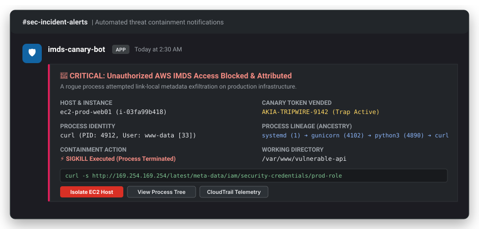

# Worked Tutorials & Practical Guides

> **Step-by-step, real-world blueprints for deploying, testing, and operationalizing `imds-canary`.**

---

## 1. 60-Second Quickstart (Dry-Run Mode)

Test the honeypot and credential vending logic on any developer laptop (macOS or Linux) without needing root privileges or Linux kernel eBPF support.

### Step 1: Start the Daemon

```bash
# Start honeypot on local port 18080 in dry-run mode
./bin/imds-canary -dry-run -port 18080 -role staging-app-role
```

Output:
```json
{"time":"2026-10-24T02:00:00Z","level":"INFO","msg":"Starting imds-canary daemon","honeypot_port":18080,"canary_role":"staging-app-role","dry_run":true}
{"time":"2026-10-24T02:00:00Z","level":"INFO","msg":"IMDS honeypot listening","addr":"127.0.0.1:18080"}
```

### Step 2: Query the Honeypot

In another terminal, simulate an application retrieving IAM security credentials:

```bash
curl -s http://127.0.0.1:18080/latest/meta-data/iam/security-credentials/staging-app-role | jq .
```

Response:
```json
{
  "Code": "Success",
  "LastUpdated": "2026-10-24T02:00:01Z",
  "Type": "AWS-HMAC",
  "AccessKeyId": "AKIA-CANARY-TOKEN-ID",
  "SecretAccessKey": "SECRET-CANARY-KEY",
  "Token": "CANARY-SESSION-TOKEN-PAYLOAD",
  "Expiration": "2026-10-24T08:00:01Z"
}
```

The daemon immediately logs an attributed access event:
```json
{"time":"2026-10-24T02:00:01Z","level":"INFO","msg":"IMDS credential requested","client_ip":"127.0.0.1","path":"/latest/meta-data/iam/security-credentials/staging-app-role","role":"staging-app-role"}
```

---

## 2. Simulating & Catching an SSRF Attack

Server-Side Request Forgery (SSRF) remains one of the primary vectors for cloud compromise. When an attacker exploits an SSRF flaw in a web application (such as an image previewer or webhook tester), they instruct the backend application to fetch `http://169.254.169.254`.

### Step 1: Start `imds-canary` on the Linux Host

```bash
sudo ./bin/imds-canary \
  -port 18080 \
  -role production-backend-role \
  -access-key-id "AKIA-TRIPWIRE-9142" \
  -secret-access-key "SECRET-CANARY-TRIPWIRE-1"
```

### Step 2: Vulnerable Web Application Simulation

Consider a vulnerable Python web service:

```python
# app.py
from flask import Flask, request
import urllib.request

app = Flask(__name__)

@app.route("/preview")
def preview():
    url = request.args.get("url")
    # Vulnerable to SSRF!
    req = urllib.request.Request(url, headers={"User-Agent": "App/1.0"})
    return urllib.request.urlopen(req).read()

if __name__ == "__main__":
    app.run(host="0.0.0.0", port=5000)
```

### Step 3: Attacker Triggers the Exploit

The attacker issues an SSRF request to fetch credentials:

```bash
curl -s "http://victim.corp/preview?url=http://169.254.169.254/latest/meta-data/iam/security-credentials/production-backend-role"
```

### Step 4: Daemon Forensic Attribution

While the attacker receives deceptive canary credentials, `imds-canary` catches the Python process and records the exact process tree:

```json
{
  "time": "2026-10-24T02:05:12Z",
  "level": "WARN",
  "msg": "ALERT: Unauthorized IMDS query intercepted",
  "event": {
    "pid": 5124,
    "comm": "python3",
    "exe": "/usr/bin/python3",
    "cmdline": "python3 app.py",
    "cwd": "/var/www/app",
    "uid": 1000,
    "parent_tree": "systemd (1) -> gunicorn (4102) -> python3 (5124)"
  }
}
```

---

## 3. Real-Time Slack & SIEM Webhook Alerting

Configure `imds-canary` to immediately dispatch signed JSON alerts to Slack, Discord, or your SOC SIEM endpoint.

```bash
sudo ./bin/imds-canary \
  -port 18080 \
  -webhook-url "https://hooks.slack.com/services/T000/B000/XXXXX" \
  -webhook-secret "my-hmac-shared-secret"
```

When an unauthorized query occurs, your incident channel instantly receives a rich alert card:



### HMAC-SHA256 Signature Verification

Every outbound webhook includes an `X-Canary-Signature: sha256=<hex>` header. Verify incoming webhooks in Python:

```python
import hmac, hashlib

def verify_webhook(secret_bytes, payload_bytes, received_header):
    expected = "sha256=" + hmac.new(secret_bytes, payload_bytes, hashlib.sha256).hexdigest()
    return hmac.compare_digest(expected, received_header)
```

---

## 4. Active Threat Containment with SIGKILL

In zero-trust or high-sensitivity environments, you can automatically terminate rogue processes the microsecond they attempt to probe IMDS.

### Step 1: Start with SIGKILL Containment

```bash
sudo ./bin/imds-canary \
  -port 18080 \
  -containment sigkill \
  -allowlist "amazon-ssm-agent,/usr/bin/amazon-ssm-agent"
```

### Step 2: Rogue Process Attempts Query

Simulate an attacker running `curl http://169.254.169.254`:

```bash
curl -s http://169.254.169.254/latest/meta-data/
```

### Step 3: Instant Termination

The process is killed before it can process any response:
```
[1]    5914 killed     curl -s http://169.254.169.254/latest/meta-data/
```

The daemon records:
```
2026/10/24 02:15:33 [ALERT] Intercepted IMDS request from unauthorized PID 5914 (/usr/bin/curl)
2026/10/24 02:15:33 [CONTAINMENT] Signal SIGKILL sent to PID 5914. Process terminated.
```

---

## 5. Integrating with AWS Canarytokens

[Thinkst Canarytokens](https://canarytokens.org) generate real, trackable AWS API keys that have no permissions. When an attacker attempts to use these keys with `aws s3 ls` or the AWS CLI, an instant alert triggers indicating the attacker's public IP and user agent.

### Step 1: Generate a Free Canarytoken

1. Navigate to [canarytokens.org/generate](https://canarytokens.org/generate).
2. Choose **AWS API Key**.
3. Supply your alert email address or webhook.
4. Note your credentials:
   * **Access Key ID**: `AKIAQAAAAAAAEXAMPLE1`
   * **Secret Access Key**: `1234567890abcdefEXAMPLESECRET`

### Step 2: Configure `imds-canary`

```bash
export CANARY_ACCESS_KEY_ID="AKIAQAAAAAAAEXAMPLE1"
export CANARY_SECRET_ACCESS_KEY="1234567890abcdefEXAMPLESECRET"
export CANARY_ROLE="prod-eks-node-role"

sudo -E ./bin/imds-canary -port 18080
```

When an attacker queries IMDS, they obtain these keys. The second they run `aws sts get-caller-identity` on the internet, Thinkst sends an alert with their source IP, ISP, and timestamp!

---

## 6. Deploying on EC2 with Systemd

Set up `imds-canary` as a hardened, persistent system service on Amazon Linux 2023 or Ubuntu EC2 instances.

### Step 1: Install Binary & Service File

```bash
sudo cp bin/imds-canary /usr/local/bin/imds-canary
sudo chmod 755 /usr/local/bin/imds-canary

# Copy systemd unit file
sudo cp init/imds-canary.service /etc/systemd/system/imds-canary.service
```

### Step 2: Configure Environment Variables

Create `/etc/default/imds-canary`:

```bash
sudo tee /etc/default/imds-canary << 'EOF'
CANARY_PORT=18080
CANARY_CGROUP=/sys/fs/cgroup
CANARY_ROLE=production-workload-role
CANARY_ACCESS_KEY_ID=AKIA-TRIPWIRE-9142
CANARY_SECRET_ACCESS_KEY=4Fk9xQv7B2wL1pM0rT5yH8nJ9sK4cZ1vX7mQ2zW6
CANARY_CONTAINMENT=sigkill
CANARY_ALLOWLIST=amazon-ssm-agent,/usr/bin/amazon-ssm-agent
CANARY_METRICS_ADDR=:9090
CANARY_LOG_FORMAT=cef
EOF
```

### Step 3: Enable & Start Service

```bash
sudo systemctl daemon-reload
sudo systemctl enable --now imds-canary
sudo systemctl status imds-canary
```

View live logs:
```bash
journalctl -u imds-canary -f
```
